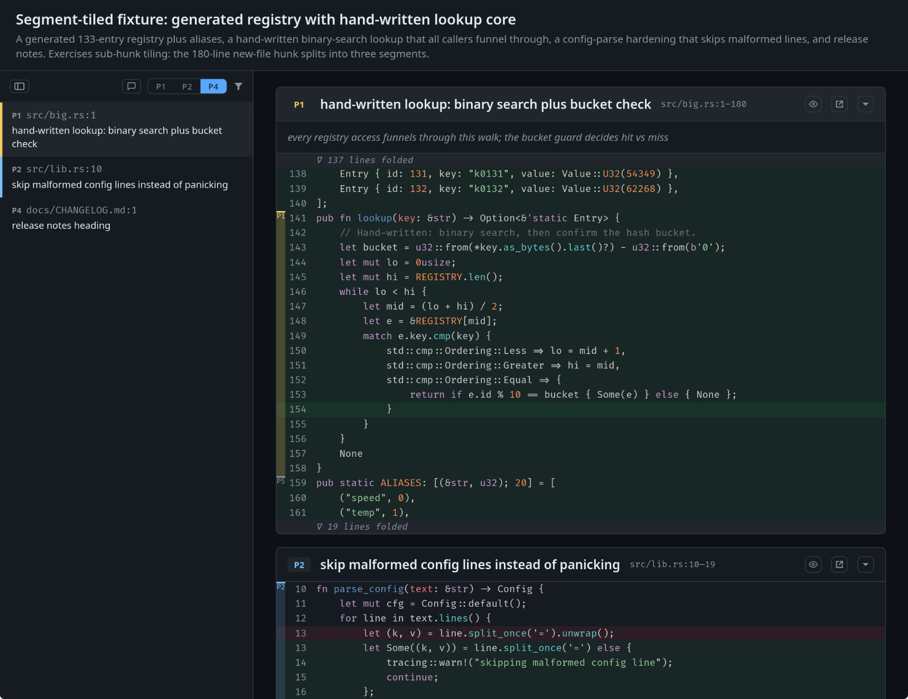

# Adhdiff — agent-annotated diff review

> Read changes by **what matters**, not by what comes first alphabetically.

Priority-tiered, agent-annotated diff review: an AI agent reviewing a
change emits an **AdhDiffMap** — JSON annotating every hunk with a
priority tier and a one-line label. Reviewers read P0–P2 (the gist)
first, mechanics later. Positional bias in review is real (Fregnan et al., ESEC/FSE 2022:
last-shown-file defects are 64% less likely found); Adhdiff makes
review order explicit and justified.

The name is ADHD + diff, pronounced "A-D-H-diff": built by someone with
ADHD for review where attention, not time, is the bottleneck.



## Installation

### Manual

1. Get the binary: bundles (`.deb`/`.AppImage`, `.dmg`, MSI/NSIS) are
   produced by CI on every push to `main` — Actions → latest `build` run
   → `adhdiff-<platform>` artifact. Tags matching `v*` publish the same
   files as a draft GitHub release.
   On Linux the runtime needs `webkit2gtk-4.1` installed.
2. Add the skill to your agent:

   | agent | install |
   |---|---|
   | Claude Code | `claude plugin marketplace add bemyak/adhdiff` → enable `adhdiff@adhdiff` |
   | Codex | symlink `skills/adhdiff` into `~/.codex/skills/` |
   | pi | `plugin = [ "adhdiff@git+https://github.com/bemyak/adhdiff.git" ]` |
   | omp | add this repo's `skills/` dir to `skills.customDirectories` |

   The skill uses the `adhdiff` binary from PATH — keep both.

### Nix (flake + Home Manager)

```nix
{
  inputs.adhdiff.url = "github:bemyak/adhdiff";
}

# in your home-manager configuration:
{
  imports = [ inputs.adhdiff.homeManagerModules.default ];
  programs.adhdiff.enable = true;
}
```

Binary installed, skill wired into codex / opencode / claude-code / omp
(only into agents whose HM modules are present). Disable the wiring with
`programs.adhdiff.enableAgentIntegration = false;`.

## Build from source

Needs Rust 1.90+ (edition 2024), [`trunk`](https://trunkrs.dev), the
`wasm32-unknown-unknown` target and, on Linux, `webkit2gtk-4.1`.

```sh
cd frontend && trunk build --release
cd .. && cargo build --release
```

The release binary embeds `frontend/dist`. For frontend hot-reload run
`trunk serve` in `frontend/` and `cargo run --no-default-features -- gui …`,
which loads `http://localhost:1420` instead.

The GUI's `e` jump needs a windowed editor (`VISUAL=code` or similar); a terminal editor has no TTY there. The GUI resolves `$VISUAL`, then `$EDITOR`; the TUI `$EDITOR`, then `$VISUAL`, else `vi`. The open button is hidden when no usable editor is configured or the file is not in the worktree.

Both viewers show `--context N` dimmed worktree lines (default 5, `0` disables) above and below every hunk; they are skipped when the file is missing or no longer matches the diff.

## CLI

```
adhdiff parse   [--input diff]                                        # diff → raw hunk inventory JSON
adhdiff enrich  [--input diff] [--workdir dir]                        # inventory + language / enclosing symbol per hunk
adhdiff prompt  [--input diff]                                        # diff → full labeling prompt for the agent
adhdiff check   [--map M] (--diff D | --diff-file F) [--strict]       # validate a map against its diff
adhdiff render  [--map M] (--diff D | --diff-file F)                  # one-shot terminal render
adhdiff tui     [--map M] --diff-file F [--out PATH] [--context N]    # interactive terminal UI
adhdiff gui     [--map M] --diff-file F [--out PATH] [--context N]    # desktop UI
adhdiff inbox   --peek | --post TEXT [--hunk F:ROW] | --done ID       # agent/reviewer feedback queue
```

## Map format

A `row` is a 1-based line number in the raw diff text, exactly what an
editor or `sed -n` shows. Entries tile every raw hunk by rows.

```jsonc
{
  "title": "one line",
  "summary": "2–3 sentences",
  "diff_sha256": "hex sha256 of the raw diff bytes",
  "hunks": [
    {
      "file": "repo/relative/path",          // readability only, identity is the row
      "row_start": 12, "row_end": 40,          // inclusive, within one raw hunk
      "priority": "P0" | ... | "P7",
      "label": "one line",
      "rationale": "1–2 sentences (P0 required, P1 recommended, else empty)",
      "mechanical": false,                     // default false
      "confidence": "high" | "medium" | "low", // default high
      "supports": 12                           // optional: row_start of the entry this supports
    }
  ]
}
```

## License

GPL-3.0-or-later © 2026 bemyak + contributors (see [LICENSE](LICENSE)).
